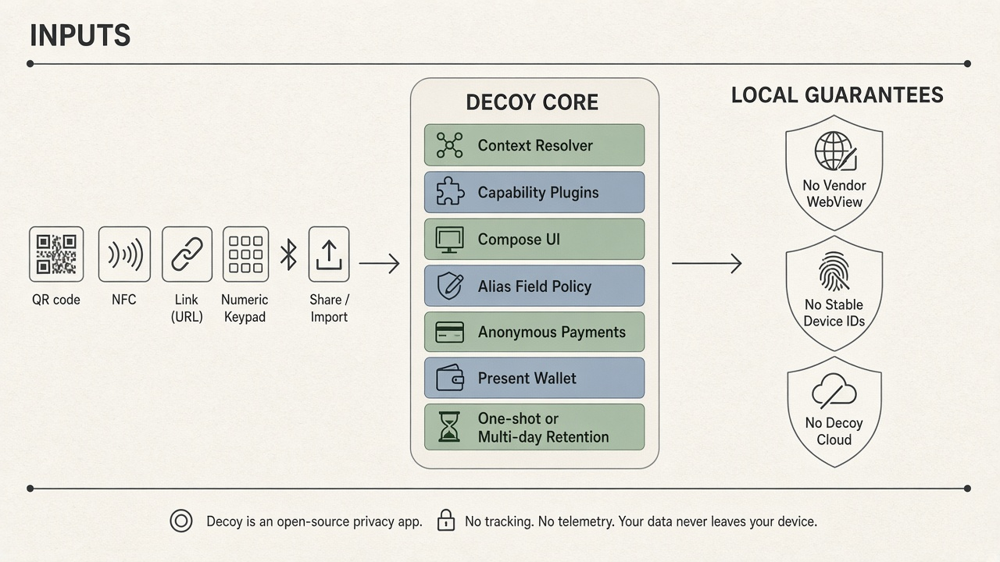

# Decoy

For a free, anonymous, and frictionless physical world.

Engineering docs live in [`docs/`](docs/README.md).

## System overview

## The Manifesto

The physical world has been hijacked by digital walls. Today, you cannot unlock a shared bicycle, order food at a campsite, sit at a terrace, start a parking session, or adjust a thermostat without being confronted by the ultimate friction of the modern internet: app fatigue, mandatory accounts, and surveillance capitalism.

Corporate entities, hospitality venues, and municipalities demand that we download a unique, often poorly constructed app from a proprietary app store for every single trivial action. They force us to accept cookies, swallow trackers, surrender our email addresses, and permanently sacrifice our license plates or location data.

We believe this is fundamentally wrong. You should not have to pay with your identity and privacy just to interact with a physical object or trigger a simple real-world service.

Decoy draws a line in the sand. We reclaim the physical interface by deploying a smart, cryptographic counter-strategy based on five radical, open-source principles.

### The Five Core Principles

#### 1. Contextual Transformation (Zero-Install & UI Overwrite)

An interface must appear exactly when you need it and vanish the moment you walk away. No app stores, no downloads, and no sluggish third-party interfaces. Decoy acts as a universal, open-source layer for the physical world.

The application instantly blocks tracking scripts and advertising pixels hidden in local networks. It actively ignores the bloated, broken web-views of campsite, parking, or restaurant applications, and instead renders a clean, native, and high-performance Jetpack Compose interface within milliseconds, powered entirely by open backend protocols.

#### 2. Universal Input (Hardware & Manual Zones)

Frictionless access must be inclusive of all infrastructure ages. Whether a physical object utilizes cutting-edge Ultra-Wideband (UWB) radio technology, instant NFC tags, QR codes, or a simple human-readable code painted on a parking pillar (e.g., Zone 4021)—Decoy processes them seamlessly.

If no hardware tag or visual code is present, the application effortlessly transitions to a clean, local numeric keypad. The input is manual, but the processing remains strictly anonymous and local.

#### 3. Masked Profiles & Zero-Knowledge Identity

We refuse to expose personal data or permanent identifiers to the infrastructure surrounding us. This is where the app earns its name: it feeds the surveillance machine a decoy.

When a vendor requires an account or contact channel, Decoy dynamically generates encrypted, single-use masked emails and anonymous aliases on-the-fly—reachable when needed, never your permanent inbox or phone number. Irrelevant form fields (home address for an on-site order, marketing opt-ins, forced sign-up) are omitted. Payment secrets never go into vendor HTML forms.

For cooperative access control that accepts cryptographic proofs, venues may verify anonymous hashes or zero-knowledge claims without receiving your real identity. Regulated identifiers (such as a license plate when the law requires it) leave the device only with explicit consent, as the real value, and are wiped under One-shot rules—not fabricated.

#### 4. One-shot vs Multi-day

Data must not permanently reside in the cloud. Decoy enforces rigorous data retention hygiene, splitting interactions into two strict categories:

- **One-shot:** One active session for a single activity (order a drink, rent a bike until return, run a parking session). Data may stay for the whole session—not only until payment—and is wiped when the session ends, with a default safety auto-destroy TTL unless the user pins that session.
- **Multi-day:** Transient relationships (such as campsite stays or short apartment rentals) are stored locally using hardware-accelerated encryption and are auto-destroyed after a pre-defined window of days unless the user extends; never permanent cloud retention.

#### 5. 100% FOSS, Local-First & Anonymous Payments

Built entirely by and for the community, Decoy contains no trackers and zero proprietary Big Tech libraries (such as Google Play Services or Firebase).

It never transmits GPS coordinates to central servers. Financial transactions are processed completely anonymously via open W3C Web Payments or open-banking relays, preventing your name or bank account number from leaking to the counterparty. Fully open-source and distributed through F-Droid, because open software is the only software you can trust.

### Conclusion

The physical world should feel analog, enhanced by the comfort of the digital age. Decoy restores that balance. Project your interface, deploy your decoy, claim your privacy, and break free from the application silos.
