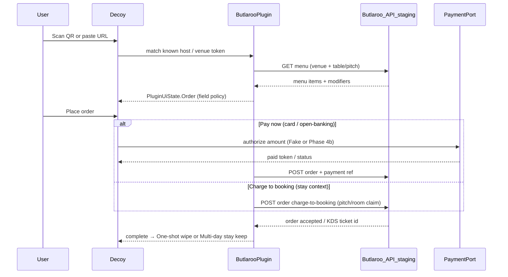

# Butlaroo adapter spike (Phase 7 candidate)

Technical sketch for a **cooperative** Decoy ↔ [Butlaroo](https://www.butlaroo.com/) capability plugin. Not implemented yet. CI stays on fixtures; live calls need partner staging credentials.

Butlaroo is a hospitality ordering OS (QR table/pitch, cottage delivery, charge-to-booking / PMS, Butlaroo Pay). Enterprise materials mention REST + webhooks at `api.butlaroo.com` — **public developer docs are not available**; this spike assumes partner API access.

## Why Butlaroo

| Decoy use case | Butlaroo surface |
|----------------|------------------|
| Terrace / campsite order (One-shot) | QR ordering → kitchen |
| Stay + pitch orders (Multi-day) | Charge to booking / cottage delivery |
| Unresolved public QR today | Real Butlaroo table QR → vendor HTTPS (no Decoy session) |

Fits Phase 7: explicit plugin + privacy-net for **known hosts only**, not “every street QR works.”

## Non-goals (this spike)

- Scraping Butlaroo guest WebViews or reverse-engineering private apps
- Embedding Butlaroo HTML in Decoy
- Production PSP settlement without Phase 4b payment rail
- Calling production `api.butlaroo.com` from CI

## Prerequisites

1. Partner / venue staging tenant + API credentials (or documented open endpoints)
2. Allowlist hosts (e.g. `api.butlaroo.com`, staging equivalent) in privacy HTTP defaults
3. Fixture twin: recorded menu/order JSON so emulator path never hits live hosts
4. Threat-model note if any residual identifiers leave the device

## Target flow — menu → order → pay / charge-to-booking



### Step detail

| Step | Decoy | Butlaroo (assumed) | Notes |
|------|-------|--------------------|-------|
| **1. Discover** | Scan / paste | Guest QR → `https://…butlaroo…` with venue + table/pitch | Today: Unresolved. With plugin: parse token only; never load vendor HTML |
| **2. Resolve** | `ButlarooOrderPlugin.matches` | — | Host allowlist + path/query shape |
| **3. Menu** | `render` → order UI | `GET` menu for venue | Cache in-session; no analytics SDKs |
| **4. Field policy** | Core classifier | Vendor may ask email/account | Alias / Omit / Consent per existing policy |
| **5a. Pay** | `PaymentPort` | Order + payment reference | Fake in CI; staging relay / 4b later |
| **5b. Charge-to-booking** | Multi-day stay attrs (`pitch`, `stayId`) | Post folio / booking line | Needs stay claim cooperative with park PMS |
| **6. Complete** | Dispose One-shot or keep vault stay | Kitchen / KDS already has ticket | History breadcrumb OK; no receipt dossier |

## Plugin shape (sketch)

```
fixtures or :plugins-butlaroo/
  ButlarooOrderPlugin          // One-shot terrace / table QR
  ButlarooStayChargePlugin     // optional: Multi-day pitch → charge-to-booking
  ButlarooFakeBackend          // CI: canned menu + accept order
  ButlarooHttpBackend          // staging only; privacy-net client
```

Match rule (illustrative):

- URL host in allowlist **and** path/query contains venue or table token  
- Injected fixture: `decoy://butlaroo/order?fixture=1` for Demo / emulator

## Real QR testing (now vs later)

| When | What to do | Expected |
|------|------------|----------|
| **Now (6b)** | Scan a real Butlaroo table QR or paste its HTTPS URL | Unresolved — decode local, no vendor call |
| **Later (7)** | Same QR with plugin + staging | Menu → order → Fake/staging pay or charge-to-booking |
| **Corpus** | Optionally add redacted sample URLs under `fixtures/public-qr/` as Unresolved cases | Document host pattern only; no live secrets |

## Open questions (block implementation)

1. Exact public vs partner API surface (auth, menu, order, charge-to-booking)?
2. Can a guest QR be resolved to venue/table **without** opening the guest web app?
3. Charge-to-booking: which claim proves “pitch 42 / room 12” without full guest PII?
4. Webhook necessity for order status, or request/response enough for v1?
5. GDPR: what leaves the device on order submit (minimal basket + pay ref only)?

## Exit for “spike done”

- [ ] Partner confirms API path (or documents gap → cooperative protocol request)
- [ ] This sketch accepted; fixture backend interface named
- [ ] Phase 7 work item unblocked or parked with explicit blocker

## Related

- [development-phases.md](development-phases.md) — Phase 7, live API ladder
- [plugins-architecture.md](plugins-architecture.md)
- [payments.md](payments.md) — Fake vs Phase 4b
- [public-qr-samples.md](public-qr-samples.md) — scan real QR → Unresolved today
- [threat-model.md](threat-model.md)
