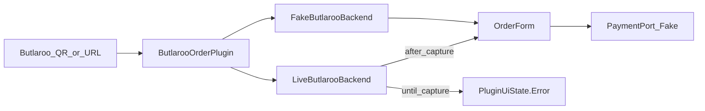

# Butlaroo adapter — UI overwrite (Phase 7 candidate)

Decoy’s product idea for vendors like [Butlaroo](https://www.butlaroo.com/): **ignore their WebView/app UI**, render native Compose, and speak only the **minimum guest backend** their QR already uses.

Partner/open API access is a later **stabilization** path, not a prerequisite for starting.

## Status

| Piece | State |
|-------|--------|
| Fixture UI overwrite (`decoy://butlaroo/order?…`) | **Shipped** — Demo + public-qr PNG |
| Host match for `*.butlaroo.app` / `*.butlaroo.com` | **Shipped** — opens plugin; live menu → capture Error |
| Live menu / order HTTP | **Blocked** on one real guest QR (+ optional HAR) |
| Partner REST (`api.butlaroo.com`) | Optional later |

CI never calls production Butlaroo hosts. Fake backend only.

## What UI overwrite means here

| Do | Do not |
|----|--------|
| Match QR/URL → Compose `OrderForm` | Load Butlaroo HTML in a WebView |
| Call allowlisted hosts via `:privacy-net` | System overlay on top of their Android app |
| Fake twin for emulator | Silent Unresolved when host is clearly Butlaroo |
| Strip account / IBAN / marketing fields | Ship production kitchen tickets without capture |

## Try now

1. Debug → **Demo fixtures** → **Butlaroo order**, or zone code `BUTLAROO`
2. Scan [`fixtures/public-qr/decoy-butlaroo-order.png`](../fixtures/public-qr/decoy-butlaroo-order.png)
3. Paste `https://order.butlaroo.app/venue/demo?table=12` → Error: *live menu not captured yet* (not generic Unresolved)

## Architecture

Code:

- `fixtures/.../butlaroo/ButlarooBackend.kt` — port + host allowlist
- `FakeButlarooBackend` / `LiveButlarooBackend`
- `ButlarooOrderPlugin`

## Capture protocol (unblocks live)

Public web search does **not** expose real table QR URLs. To fill `LiveButlarooBackend`:

1. At a venue (or from a willing operator), scan one table QR
2. Copy the HTTPS landing URL (strip personal query params if any)
3. Optionally export a browser HAR of the menu load (XHR/fetch only)
4. Record: auth handshake (e.g. client register), menu GET, order POST shapes
5. Implement those calls behind the allowlist; keep Fake as CI default
6. Add a redacted sample URL under `fixtures/public-qr/` docs (no secrets)

Until then, live hosts stay on the explicit capture Error screen.

## Target flow (after capture)

Menu → order → pay (Fake / Phase 4b) or later charge-to-booking for Multi-day stays. Same sequence as earlier spike diagrams; Fake pay only in CI.

## Open questions

1. Exact guest API paths after QR land (needs capture)
2. Whether table id is always in the URL vs session cookie (Decoy uses empty cookie jar — may need token in query)
3. Charge-to-booking claims without full guest PII
4. Residual identifiers on order submit (threat-model update if needed)

## Related

- [development-phases.md](development-phases.md) — Phase 7
- [plugins-architecture.md](plugins-architecture.md) — open protocol vs UI overwrite
- [public-qr-samples.md](public-qr-samples.md)
- [payments.md](payments.md)
- [threat-model.md](threat-model.md)
