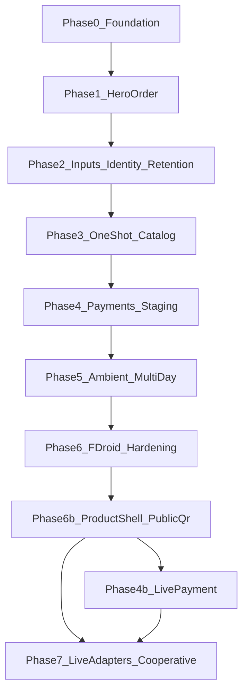

# Development phases

Ordered build path from the specs to a first F-Droid release. Each phase has an outcome, work items, tests, non-goals, and exit criteria.

Aligned with [product-spec.md](product-spec.md), [use-cases.md](use-cases.md), [plugins-architecture.md](plugins-architecture.md), [e2e-testability.md](e2e-testability.md), and [threat-model.md](threat-model.md).

## Stack

| Choice | Value |
|--------|-------|
| Language | Kotlin |
| UI | Jetpack Compose |
| Shape | Multi-module Android app |
| Distribution target | F-Droid |
| Forbidden | Google Play Services, Firebase, proprietary analytics |

## Phase overview

After **Phase 0 (Foundation)**, **Phase 1** proves the core with the campsite/terrace hero order flow on fixtures. Later phases harden inputs, expand One-shot fixtures, add payment ports, Multi-day surfaces, F-Droid posture, then a **product shell** with real QR scan. **Live vendor APIs** wait until Phase 7 (and live payment rail as Phase 4b).

Generic ticket/loyalty import-and-show wallets are **out of scope** (see [non-goals.md](non-goals.md)).

## Live API ladder

| Step | Phase | Live network? |
|------|-------|----------------|
| Fixtures / inject / Demo sheet | 0–6 | No (CI stubs) |
| Scan/decode public QR → plugin or Unresolved | 6b | Decode local; vendor API **no** |
| Real open-banking / Web Payments rail | 4b | Yes — payment only |
| First venue/capability live adapter | 7 / M5 | Yes — per explicit plugin |
| Arbitrary retail/parking without open adapter | — | **Out of scope** |

## Cross-cutting rules

Apply in every phase:

- **Emulator-first:** every feature must be fully exercisable on an AVD with mocks/stubs — see [e2e-testability.md](e2e-testability.md)
- Fixture/fake backends before any live vendor integration; CI never depends on production vendor hosts
- Debug **Demo sheet** (or scripted `adb` intents) for fixture inject; product home is scan-first
- Injected inputs for QR, NFC, BLE (no physical hardware required to merge)
- No Play Services / Firebase / analytics SDKs in core or plugins
- Phase exit = features **plus** privacy tests on emulator — not a UI demo alone
- No stable device IDs; empty cookie jar; no vendor WebView on happy paths ([threat-model.md](threat-model.md))

---

## Phase 0 — Foundation

**Outcome:** product shell that enforces privacy defaults and can host plugins.

### Modules (initial sketch)

| Module | Role |
|--------|------|
| `:app` | Compose shell, navigation, entry points |
| `:core` | Context resolver, session lifecycle, retention orchestration |
| `:privacy-net` | HTTP client, interceptors, ID bans |
| `:plugins-api` | Plugin contract (discover → resolve → render → complete → dispose) |
| `:fixtures` | Deterministic payloads, stub backends, injected-input helpers for emulator CI |

Names may be refined at implement time; responsibilities must not blur.

### Work

- Compose app shell; **no** WebView dependency in core
- Privacy HTTP client: empty cookie jar, no stable device IDs, interceptor hooks
- Plugin API lifecycle as in [plugins-architecture.md](plugins-architecture.md)
- Retention primitives: One-shot session nonce + wipe; Multi-day store **interface** (stub implementation OK)
- **Mock harness:** dependency injection seams for network, payments, and input sources; debug build can bind all stubs
- CI: unit tests + instrumented emulator smoke + banned-API grep (`AdvertisingIdClient`, Play/Firebase imports)

### Tests

- App launches on emulator
- Hello fake plugin renders a Compose screen via stub binding
- Injected “QR” payload resolves without camera hardware
- CI fails on banned imports / ID APIs

### Non-goals

- Real venue integrations
- Ticket/loyalty code wallets
- Real payments

### Exit criteria

- [x] App launches on emulator (`:app:assembleDebug` builds; install via `installDebug`)
- [x] Fake plugin shows Compose UI via plugin API with stubs only (`HelloFixturePlugin`)
- [x] Privacy CI gates green (`./gradlew test` + `scripts/check-banned-apis.ps1`)
- [x] Documented how to run the smoke flow on an AVD ([dev-setup.md](dev-setup.md))

---

## Phase 1 — Hero order flow

**Outcome:** core architecture proven on campsite / terrace ordering with fixtures only.

### Work

- QR + URL parse → ContextResolver → fixture plugins (no live vendors)
- Compose order UI
- Field classifier: needed / alias / pay-elsewhere / omit
- **Campsite sandwich hero:** keep pitch; alias email; block IBAN in forms; omit home address
- **Terrace table-QR:** menu fixture → order → complete
- Payment **fake** adapter (success / fail only)
- One-shot wipe on complete or dismiss

### Tests

- Fixtures: campsite form schema, terrace menu JSON
- Privacy assertions: no WebView, no cookies across sessions, no GPS/stable IDs in requests
- Wipe leaves no PII in local DB/prefs
- [e2e-testability.md](e2e-testability.md) acceptance checklist for these use cases

### Non-goals

- Live campsite/restaurant backends
- Real PSP settlement
- Multi-day stay product (interface only if needed for pitch context)
- Import/show code or ticket wallet

### Exit criteria

- [x] Campsite and terrace fixture flows complete end-to-end **on emulator with stubs**
- [x] Field policy assertions pass (keep / alias / omit / pay-elsewhere)
- [x] One-shot wipe + privacy network assertions green
- [x] Both flows reachable from debug/demo harness (or `adb` intent)

---

## Phase 2 — Inputs, identity, retention hardening

**Outcome:** core MVP inputs and durable local Multi-day vault.

### Work

- NFC + manual zone / short-code keypad through ContextResolver
- Alias generator (local generation; configurable relay later)
- Multi-day encrypted vault (e.g. campsite stay pitch context)
- Walk-away / dismiss dispose behavior for active contexts

### Tests

- Keypad and NFC (injected events) trigger hero plugin
- Multi-day TTL unit + instrumented expiry/delete tests
- Alias used for contact fields; no global Decoy user id uploaded

### Non-goals

- BLE / UWB (Phase 5)
- Real alias email relay hosting (document config only if needed)

### Exit criteria

- [x] QR, URL, NFC, keypad all resolve into plugins
- [x] Multi-day vault encrypts and TTL-wipes
- [x] Dispose on walk-away/dismiss verified

---

## Phase 3 — One-shot catalog (fixture-first)

**Outcome:** remaining v1 One-shot use cases runnable on fakes.

### Work

Fake plugins + fixtures for:

- Parking (zone / QR)
- Captive portal Wi-Fi
- EV charging start/stop stub
- Vending / locker / laundry QR pay

Manual keypad remains a shared trigger variant. Each case meets the acceptance checklist in [e2e-testability.md](e2e-testability.md).

### Tests

- Per-use-case fixture + fake success path
- Hard-require-surplus-fields failure path where relevant
- Retention = One-shot wipe asserted

### Non-goals

- Live operator APIs
- Toll / congestion (backlog; regulated)

### Exit criteria

- [x] All listed One-shot v1 cases have fixtures and green e2e checklists
- [x] Linked from [use-cases.md](use-cases.md)

---

## Phase 4 — Payments (staging)

**Outcome:** open payment **port** with Fake (CI) + in-process staging open-banking relay.

### Work

- Payment port already used by the fake; add Web Payments / open-banking relay adapter shape
- Never paste IBAN/card into vendor HTML forms (product + test invariant)
- Keep fakes as CI default; staging path for manual verification
- Residual PSP/bank linkability remains documented in [threat-model.md](threat-model.md)

### Tests

- Adapter contract tests (fake + staging mock)
- Assertion: order flow never places IBAN into vendor field payloads
- CI still uses fake payment

### Non-goals

- Supporting every PSP
- Claiming payment anonymity stronger than the threat model allows
- Production PSP settlement (see Phase 4b)

### Exit criteria

- [x] One staging payment path works for hero order
- [x] CI remains fake-default and green
- [x] IBAN-in-form ban enforced in tests

---

## Phase 4b — Live payment rail (after 6b)

**Outcome:** one real open-banking / Web Payments path against a staging or production-capable relay (still out-of-band; no IBAN in vendor forms).

### Work

- HTTP `PaymentRelayClient` (or equivalent) behind the same `PaymentPort`
- Keep Fake as CI default
- Document residual PSP linkability

### Non-goals

- Every PSP; claiming anonymity beyond the threat model

### Exit criteria

- [ ] One live/staging payment path completes hero order manually
- [ ] CI remains fake-default and green

---

## Phase 5 — Ambient + Multi-day product surfaces

**Outcome:** ambient discovery and full Multi-day product flows.

### Work

- BLE proximity (local-only; never as cloud location telemetry)
- Captive portal polish
- Multi-day flows: campsite stay, short-stay apartment/cabin, festival/venue pass
- UWB when hardware allows — same UX contract as BLE

### Tests

- Multi-day stay + One-shot coexist without cross-leaking session/device IDs
- BLE resolution uses fixtures/injected advertisements in CI
- TTL wipe for stay/pass contexts

### Non-goals

- Play-only Nearby APIs
- Cloud geolocation
- Rich Matter/Thread home control (backlog)
- Generic ticket/loyalty import-and-show wallet

### Exit criteria

- [x] BLE-triggered resolve works via injected advertisements in CI (same injection model as NFC; hardware optional later)
- [x] Multi-day use cases from [use-cases.md](use-cases.md) meet e2e checklist
- [x] No ID leakage across retention classes

---

## Phase 6 — F-Droid hardening and release

**Outcome:** F-Droid-ready FOSS release posture (publishing may be deferred).

### Work

- F-Droid metadata / reproducible build posture
- Full proprietary-dependency audit
- Privacy regression suite as release gate
- Release notes pointing at manifesto + docs
- **Publishing to f-droid.org deferred** until maintainers choose a tag — see [fdroid.md](fdroid.md)

### Tests

- Full privacy suite green on release tag
- Dependency audit clean (no Play/Firebase/analytics)

### Non-goals

- Play Store listing as primary distribution
- Mandatory immediate F-Droid.org inclusion

### Exit criteria

- [x] F-Droid-ready local artifact path + metadata prepared ([fdroid.md](fdroid.md); publish deferred)
- [x] Release gate checklist documented ([release-gate.md](release-gate.md))

---

## Phase 6b — Product shell + public QR

**Outcome:** end-product home (ready to scan); fixtures behind debug Demo; FOSS camera QR; public samples; Unresolved for unknown URLs.

### Work

- Product home: brand hero, Scan, Zone or link, active Multi-day vault strip
- FOSS QR camera (CameraX + ZXing) — no Play ML Kit
- Unresolved screen for unknown public payloads (nothing sent to vendor)
- Public sample PNGs under `fixtures/public-qr/`
- Demo sheet (debug only) for fixture inject + payment backend toggle

### Tests

- Unit/emulator: paste/inject still green
- Manual: scan printed public samples → known plugin or Unresolved

### Non-goals

- Live vendor APIs from arbitrary public QR codes
- Vendor WebView of scanned URLs
- Play barcode / ML Kit

### Exit criteria

- [x] Product home is the default shell (not a scenario dashboard)
- [x] Scan or paste resolves known fixtures; unknown → Unresolved
- [x] Public QR samples documented ([public-qr-samples.md](public-qr-samples.md))

---

## Phase 7 — Live adapters + cooperative protocols

**Outcome:** first live capability adapters and/or venues that speak Decoy-native claims.

### Work

- One cooperating venue or open protocol + explicit plugin (privacy-net on fetches)
- Optional minimal capability-fetch for **known** hosts only
- Venue claims such as `paid`, `pitch 42` instead of full PII forms where they cooperate
- Optional cryptographic / ZKP-style verification **only** where verifiers cooperate
- Document migration from UI-overwrite fixtures to open adapters

### Non-goals

- Required for first F-Droid-ready posture (M4)
- Scraping private vendor apps
- “Every QR on the street works”
- Fabricating regulated identifiers

### Exit criteria

- [ ] At least one live or cooperative adapter + protocol sketch
- [ ] Threat model updated if guarantees change

---

## Milestones

| Milestone | Phases | Ship signal |
|-----------|--------|-------------|
| **M0** | 0 | Privacy shell + plugin hello |
| **M1** | 0 + 1 | Hero order on fixtures (campsite + terrace) |
| **M2** | 2 + 3 | Core inputs + several One-shot fakes |
| **M3** | 4 + 5 | Staging payments + Multi-day stays |
| **M4** | 6 | F-Droid-ready posture (publish may be deferred) |
| **M4b** | 6b | Product shell + public QR scan/Unresolved |
| **M5** | 4b and/or 7 | First live payment and/or first live venue adapter |

## Related docs

- [Product spec](product-spec.md)
- [Use cases](use-cases.md)
- [Plugins architecture](plugins-architecture.md)
- [End-to-end testability](e2e-testability.md)
- [Threat model](threat-model.md)
- [Data lifecycle](data-lifecycle.md)
- [Non-goals](non-goals.md)
