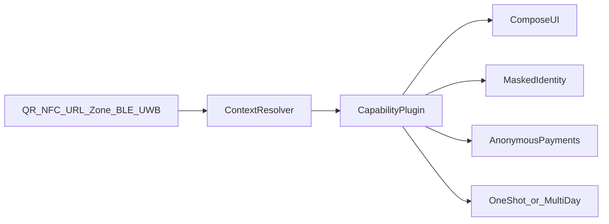

# Plugins architecture

Decoy core resolves context and hosts UI. **Capability plugins** implement venue- or protocol-specific behavior without pulling proprietary SDKs into the core.

## Core vs plugins

| Layer | Responsibility |
|-------|----------------|
| Core | Inputs, context resolver, Compose shell, retention, identity field policy, payment orchestration, Present wallet shell, privacy HTTP defaults |
| Plugins | Know a venue/protocol: parse payloads, fetch capabilities, map fields, drive flow to completion |

Plugin kinds (logical):

- **Input helpers** — specialized parsers (e.g. a pass format)
- **Venue / protocol** — campsite menu, parking zone, bike lock API
- **Payment adapters** — Web Payments / open-banking relays
- **Identity helpers** — alias providers
- **Present importers** — `.pkpass`, PDF ticket extractors

## Lifecycle

1. **Discover** — QR / NFC / URL / zone / BLE / share import
2. **Resolve** — Context resolver selects plugin (or Present wallet)
3. **Render** — Plugin supplies state; core renders Compose UI
4. **Complete** — Pay / unlock / order / present
5. **Dispose** — One-shot wipe or Multi-day persist with TTL

Share-import flows skip venue resolve and enter **Present wallet** directly (see [use-cases.md](use-cases.md)).

## Isolation rules

- No proprietary Big Tech SDKs in core (no Play Services / Firebase)
- Plugins declare required permissions and whether network is needed
- Default: no WebView; if a plugin proposes HTML, it must be exceptional and reviewed
- Plugins must not read or send stable device IDs ([threat-model.md](threat-model.md))
- Plugins must not embed vendor surveillance SDKs

## Open protocol vs UI overwrite

| Mode | When |
|------|------|
| Open protocol adapter | Venue speaks a documented or reverse-understood capability API |
| UI overwrite | Vendor only offers a broken WebView/app; Decoy ignores HTML UI and speaks the minimum backend needed—or a Decoy-native URI |

Long-term preference: cooperative open protocols so vendors request claims (`paid`, `pitch 42`) instead of full PII forms.

## Present wallet plugins

Importers run only on user-initiated share / open-with / SAF / clipboard. They extract a presentable token into local storage. They never scrape other apps’ private data.

## Testing hooks

Every plugin should run against fake/stub backends and fixtures so e2e tests do not need live surveillance vendors. See [e2e-testability.md](e2e-testability.md).

## Related docs

- [Product spec](product-spec.md)
- [Threat model](threat-model.md)
