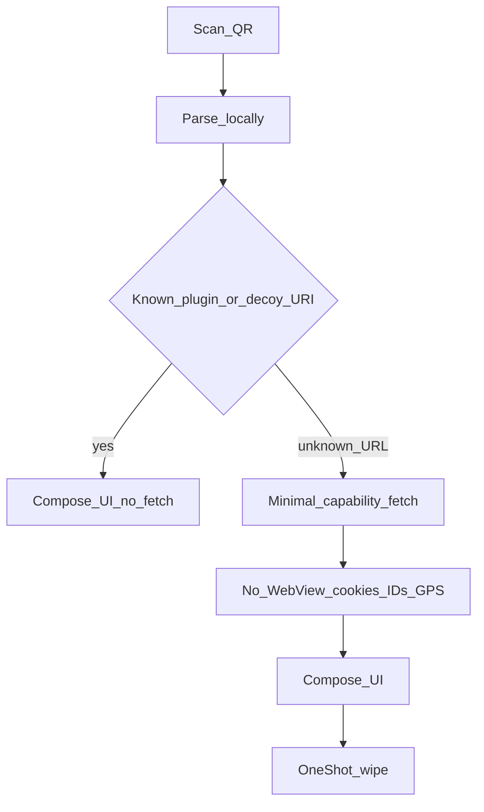

# Threat model

This document is a product privacy model, not legal advice.

## Assets

- User PII (email, phone, address, plate, payment instruments)
- Multi-day local contexts (pitch, access tokens, event pass credentials)
- Device sensors (GPS, BLE, camera) used only for local resolution

## Adversaries

| Adversary | Interest |
|-----------|----------|
| Vendor / venue app & WebView | Accounts, trackers, surplus form fields, device fingerprint |
| Adtech embedded in venue pages | Cross-site / cross-venue profiling |
| Network observer on venue Wi-Fi | Cleartext or metadata |
| Decoy project (us) | Must not become a data honeypot — hence no Decoy cloud for core |
| Device thief / malware | Local vault contents |

## Trust boundaries

- **Inside device (trusted for local secrets):** Decoy core, encrypted stores, ephemeral session state
- **Counterparty (untrusted):** vendor APIs, payment PSPs, enforcement systems
- **No Decoy cloud** in the trust model for core flows

## Hero threat

Vendors collecting surplus PII for trivial local transactions (e.g. home address + phone + IBAN to buy campsite sandwiches).

## Anonymity levels (do not collapse these)

| Level | Strength | Meaning |
|-------|----------|---------|
| Anonymous to Decoy | Hard guarantee | No Decoy cloud, telemetry, or account |
| Anonymous to adtech / trackers | Hard on happy path | No vendor WebView/HTML; no cookies, pixels, fingerprint JS; Compose UI only |
| Unlinkable across merchant sessions | Best-effort | Single-use aliases, One-shot wipe, no stable device IDs |
| Invisible to merchant for a fulfilled order | Not claimed | Merchant sees pitch/table and that someone paid |

## Guarantees

- Omit irrelevant fields; alias contact channels
- Never paste IBAN/card into vendor HTML forms
- One-shot wipe; Multi-day TTL wipe
- No GPS upload to Decoy or adtech
- No stable device IDs read for product logic or sent to counterparties

## Non-guarantees

- Vendor may reject an order if they hard-require surplus fields
- Alias ≠ legal anonymity
- True ZKP / cooperative hashes need a verifier that accepts them
- Payment PSP / bank can still correlate
- IP address and physical presence correlate

## QR → generated UI pipeline

Controls after scan:

1. Parse on-device first; `decoy://` / zone / known plugin → UI with **zero** vendor fetch
2. No WebView by default
3. If menu/tariff fetch is required: empty cookie jar, ephemeral session, generic UA, no `Referer`, no GAID / `ANDROID_ID` / install-UUID, no GPS
4. Pay out-of-band
5. One-shot wipe

Physical residual: being on-site already binds place/time. Decoy shrinks the *digital* dossier.

Optional Tor/VPN is user choice later; Decoy is not a VPN ([non-goals.md](non-goals.md)).

## No stable device IDs

### Ban list

Never read for product logic, never send to counterparties, never log:

- `ANDROID_ID`, GAID/AAID, hardware serials, MAC, IMEI/IMSI
- Firebase / Crashlytics / Play Install Referrer IDs
- App install-UUID persisted and reused across venues/sessions
- Persistent cookies, WebView `localStorage`, or cross-session TLS tickets reused across One-shot contexts where controllable

### Replace with

- **Ephemeral session nonce** (128+ bit) per context; destroyed on wipe
- **Per-counterparty alias** — no global Decoy user id
- **Multi-day** encrypted local records keyed by random id — never uploaded

### Engineering guards

- Network interceptor asserts: reject known ID headers / GAID
- CI + e2e bans on `AdvertisingIdClient` and similar APIs
- Default HTTP client: empty cookie jar; no device-keyed persistent cache
- No analytics SDK in core

### Residual correlation

IP, PSP/bank account, and reused aliases can still link sessions. Decoy removes *device* stability, not all correlation.

## Regulated identifiers

Misleading regulated systems with fabricated plates or government IDs is **not** a product feature. When a real identifier is legally required, Decoy asks explicit consent, sends the real value, and applies wipe rules.

## Residual risks

- Device compromise exposes local vault
- Alias correlation if the user reuses aliases badly
- ToS that hard-require real contact
- Coercive forms with no guest path (order may fail)
- Payment and IP linkability

## Related docs

- [Product spec](product-spec.md)
- [Data lifecycle](data-lifecycle.md)
- [E2E testability](e2e-testability.md)
